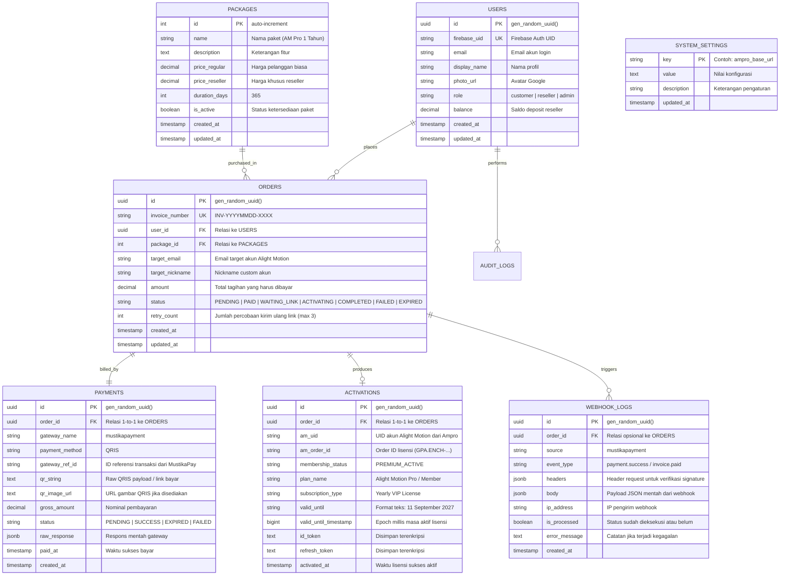

# Entity Relationship Diagram (ERD) & Database Specification
**Proyek:** Website Jualan Alight Motion Premium (AM Pro)  
**Integrasi:** Firebase Auth, Mustika Payment, & API Ampro Activator  
**Database Target:** PostgreSQL / Supabase  

---

## 1. Visual Entity Relationship Diagram (ERD)



---

## 2. Physical Data Model (PDM) & Data Dictionary

### Tabel: `users`
| Nama Kolom | Tipe Data | Nullable | Default | Keterangan |
| :--- | :--- | :---: | :--- | :--- |
| `id` | `UUID` | NO | `gen_random_uuid()` | Primary Key unik internal |
| `firebase_uid` | `VARCHAR(128)` | NO | - | Unique Key sinkronisasi Firebase Auth |
| `email` | `VARCHAR(255)` | NO | - | Email login akun |
| `display_name`| `VARCHAR(100)` | YES | NULL | Nama pengguna |
| `photo_url` | `TEXT` | YES | NULL | URL avatar profil |
| `role` | `VARCHAR(20)` | NO | `'customer'` | Enum: `customer`, `reseller`, `admin` |
| `balance` | `NUMERIC(12,2)` | NO | `0.00` | Saldo deposit (khusus reseller) |
| `created_at` | `TIMESTAMPTZ` | NO | `NOW()` | Waktu registrasi |
| `updated_at` | `TIMESTAMPTZ` | NO | `NOW()` | Waktu data diperbarui |

### Tabel: `packages`
| Nama Kolom | Tipe Data | Nullable | Default | Keterangan |
| :--- | :--- | :---: | :--- | :--- |
| `id` | `SERIAL` | NO | Auto | Primary Key |
| `name` | `VARCHAR(100)` | NO | - | Misal: "AM Pro 1 Tahun Akun Pribadi" |
| `description` | `TEXT` | YES | NULL | Deskripsi keuntungan lisensi |
| `price_regular`| `NUMERIC(12,2)`| NO | - | Harga jual untuk customer umum |
| `price_reseller`| `NUMERIC(12,2)`| NO | - | Harga khusus untuk akun role reseller |
| `duration_days`| `INT` | NO | `365` | Masa aktif dalam satuan hari |
| `is_active` | `BOOLEAN` | NO | `TRUE` | Toggle tampil di katalog |
| `created_at` | `TIMESTAMPTZ` | NO | `NOW()` | Waktu dibuat |
| `updated_at` | `TIMESTAMPTZ` | NO | `NOW()` | Waktu diupdate |

### Tabel: `orders`
| Nama Kolom | Tipe Data | Nullable | Default | Keterangan |
| :--- | :--- | :---: | :--- | :--- |
| `id` | `UUID` | NO | `gen_random_uuid()` | Primary Key |
| `invoice_number`| `VARCHAR(50)` | NO | - | Unique Key faktur (INV-20261011-0001) |
| `user_id` | `UUID` | NO | - | Foreign Key ke `users.id` |
| `package_id` | `INT` | NO | - | Foreign Key ke `packages.id` |
| `target_email`| `VARCHAR(255)` | NO | - | Email akun Alight Motion yang akan diaktivasi |
| `target_nickname`| `VARCHAR(100)`| YES | NULL | Nama custom yang muncul di profil AM |
| `amount` | `NUMERIC(12,2)`| NO | - | Nominal total invoice yang harus dibayar |
| `status` | `VARCHAR(30)` | NO | `'PENDING'` | `PENDING`, `PAID`, `WAITING_LINK`, `ACTIVATING`, `COMPLETED`, `FAILED`, `EXPIRED` |
| `retry_count` | `INT` | NO | `0` | Jumlah berapa kali link diminta ulang (limit 3x) |
| `created_at` | `TIMESTAMPTZ` | NO | `NOW()` | Waktu pembuatan order |
| `updated_at` | `TIMESTAMPTZ` | NO | `NOW()` | Waktu status berganti |

### Tabel: `payments`
| Nama Kolom | Tipe Data | Nullable | Default | Keterangan |
| :--- | :--- | :---: | :--- | :--- |
| `id` | `UUID` | NO | `gen_random_uuid()` | Primary Key |
| `order_id` | `UUID` | NO | - | Foreign Key 1-to-1 ke `orders.id` |
| `gateway_name`| `VARCHAR(50)` | NO | `'mustikapayment'`| Nama gateway |
| `payment_method`| `VARCHAR(50)` | NO | `'QRIS'` | Metode bayar |
| `gateway_ref_id`| `VARCHAR(100)` | YES | NULL | ID Transaksi dari Mustika Payment |
| `qr_string` | `TEXT` | YES | NULL | Raw payload QRIS untuk di-render jadi QR |
| `qr_image_url`| `TEXT` | YES | NULL | URL gambar QR dari gateway |
| `gross_amount`| `NUMERIC(12,2)`| NO | - | Nominal pembayaran |
| `status` | `VARCHAR(30)` | NO | `'PENDING'` | Status bayar: `PENDING`, `SUCCESS`, `EXPIRED` |
| `raw_response`| `JSONB` | YES | NULL | Payload JSON balasan API gateway saat create |
| `paid_at` | `TIMESTAMPTZ` | YES | NULL | Waktu callback lunas |
| `created_at` | `TIMESTAMPTZ` | NO | `NOW()` | Waktu pembuatan invoice bayar |

### Tabel: `activations`
| Nama Kolom | Tipe Data | Nullable | Default | Keterangan |
| :--- | :--- | :---: | :--- | :--- |
| `id` | `UUID` | NO | `gen_random_uuid()` | Primary Key |
| `order_id` | `UUID` | NO | - | Foreign Key Unique ke `orders.id` |
| `am_uid` | `VARCHAR(128)` | YES | NULL | UID akun Alight Motion hasil aktivasi |
| `am_order_id` | `VARCHAR(100)` | YES | NULL | Order ID lisensi (GPA.ENCH-...) |
| `membership_status` | `VARCHAR(50)` | YES | NULL | Status: `'PREMIUM_ACTIVE'` |
| `plan_name` | `VARCHAR(100)` | YES | NULL | Nama plan: `'Alight Motion Pro / Member'` |
| `subscription_type` | `VARCHAR(100)` | YES | NULL | `'Yearly VIP License'` |
| `valid_until` | `VARCHAR(100)` | YES | NULL | Format tanggal string (misal: "11 September 2027") |
| `valid_until_timestamp` | `BIGINT` | YES | NULL | Timestamp epoch milidetik kedaluwarsa |
| `id_token` | `TEXT` | YES | NULL | Token sesi lisensi (terenkripsi) |
| `refresh_token`| `TEXT` | YES | NULL | Refresh token lisensi (terenkripsi) |
| `activated_at`| `TIMESTAMPTZ` | NO | `NOW()` | Waktu verifikasi sukses |

### Tabel: `webhook_logs`
| Nama Kolom | Tipe Data | Nullable | Default | Keterangan |
| :--- | :--- | :---: | :--- | :--- |
| `id` | `UUID` | NO | `gen_random_uuid()` | Primary Key |
| `order_id` | `UUID` | YES | NULL | Foreign Key ke `orders.id` jika teridentifikasi |
| `source` | `VARCHAR(50)` | NO | `'mustikapayment'`| Asal webhook |
| `event_type` | `VARCHAR(100)` | YES | NULL | Tipe event callback |
| `headers` | `JSONB` | YES | NULL | Header HTTP callback (signature, dll.) |
| `body` | `JSONB` | NO | - | Body JSON callback lengkap |
| `ip_address` | `VARCHAR(45)` | YES | NULL | IP pengirim (verifikasi whitelist) |
| `is_processed`| `BOOLEAN` | NO | `FALSE` | Flag idempotency penanda transaksi sudah diproses |
| `error_message`| `TEXT` | YES | NULL | Catatan jika pemrosesan gagal |
| `created_at` | `TIMESTAMPTZ` | NO | `NOW()` | Waktu webhook diterima |

### Tabel: `system_settings`
| Nama Kolom | Tipe Data | Nullable | Default | Keterangan |
| :--- | :--- | :---: | :--- | :--- |
| `key` | `VARCHAR(50)` | NO | - | Primary Key pengenal setting |
| `value` | `TEXT` | NO | - | Nilai setting |
| `description` | `TEXT` | YES | NULL | Keterangan kegunaan setting |
| `updated_at` | `TIMESTAMPTZ` | NO | `NOW()` | Waktu perubahan terakhir |

---

## 3. SQL DDL Script (PostgreSQL / Supabase Ready)

```sql
-- Aktifkan ekstensi UUID
CREATE EXTENSION IF NOT EXISTS "pgcrypto";

-- 1. USERS
CREATE TABLE users (
    id UUID PRIMARY KEY DEFAULT gen_random_uuid(),
    firebase_uid VARCHAR(128) NOT NULL UNIQUE,
    email VARCHAR(255) NOT NULL,
    display_name VARCHAR(100),
    photo_url TEXT,
    role VARCHAR(20) NOT NULL DEFAULT 'customer' CHECK (role IN ('customer', 'reseller', 'admin')),
    balance NUMERIC(12, 2) NOT NULL DEFAULT 0.00 CHECK (balance >= 0),
    created_at TIMESTAMPTZ NOT NULL DEFAULT NOW(),
    updated_at TIMESTAMPTZ NOT NULL DEFAULT NOW()
);
CREATE INDEX idx_users_firebase_uid ON users(firebase_uid);
CREATE INDEX idx_users_role ON users(role);

-- 2. PACKAGES
CREATE TABLE packages (
    id SERIAL PRIMARY KEY,
    name VARCHAR(100) NOT NULL,
    description TEXT,
    price_regular NUMERIC(12, 2) NOT NULL CHECK (price_regular >= 0),
    price_reseller NUMERIC(12, 2) NOT NULL CHECK (price_reseller >= 0),
    duration_days INT NOT NULL DEFAULT 365,
    is_active BOOLEAN NOT NULL DEFAULT TRUE,
    created_at TIMESTAMPTZ NOT NULL DEFAULT NOW(),
    updated_at TIMESTAMPTZ NOT NULL DEFAULT NOW()
);

-- 3. ORDERS
CREATE TABLE orders (
    id UUID PRIMARY KEY DEFAULT gen_random_uuid(),
    invoice_number VARCHAR(50) NOT NULL UNIQUE,
    user_id UUID NOT NULL REFERENCES users(id) ON DELETE RESTRICT,
    package_id INT NOT NULL REFERENCES packages(id) ON DELETE RESTRICT,
    target_email VARCHAR(255) NOT NULL,
    target_nickname VARCHAR(100),
    amount NUMERIC(12, 2) NOT NULL CHECK (amount >= 0),
    status VARCHAR(30) NOT NULL DEFAULT 'PENDING' CHECK (status IN (
        'PENDING', 'PAID', 'WAITING_LINK', 'ACTIVATING', 'COMPLETED', 'FAILED', 'EXPIRED'
    )),
    retry_count INT NOT NULL DEFAULT 0,
    created_at TIMESTAMPTZ NOT NULL DEFAULT NOW(),
    updated_at TIMESTAMPTZ NOT NULL DEFAULT NOW()
);
CREATE INDEX idx_orders_invoice ON orders(invoice_number);
CREATE INDEX idx_orders_user_id ON orders(user_id);
CREATE INDEX idx_orders_status ON orders(status);

-- 4. PAYMENTS
CREATE TABLE payments (
    id UUID PRIMARY KEY DEFAULT gen_random_uuid(),
    order_id UUID NOT NULL UNIQUE REFERENCES orders(id) ON DELETE CASCADE,
    gateway_name VARCHAR(50) NOT NULL DEFAULT 'mustikapayment',
    payment_method VARCHAR(50) NOT NULL DEFAULT 'QRIS',
    gateway_ref_id VARCHAR(100),
    qr_string TEXT,
    qr_image_url TEXT,
    gross_amount NUMERIC(12, 2) NOT NULL CHECK (gross_amount >= 0),
    status VARCHAR(30) NOT NULL DEFAULT 'PENDING' CHECK (status IN ('PENDING', 'SUCCESS', 'EXPIRED', 'FAILED')),
    raw_response JSONB,
    paid_at TIMESTAMPTZ,
    created_at TIMESTAMPTZ NOT NULL DEFAULT NOW()
);
CREATE INDEX idx_payments_order_id ON payments(order_id);
CREATE INDEX idx_payments_gateway_ref ON payments(gateway_ref_id);

-- 5. ACTIVATIONS
CREATE TABLE activations (
    id UUID PRIMARY KEY DEFAULT gen_random_uuid(),
    order_id UUID NOT NULL UNIQUE REFERENCES orders(id) ON DELETE CASCADE,
    am_uid VARCHAR(128),
    am_order_id VARCHAR(100),
    membership_status VARCHAR(50) DEFAULT 'PREMIUM_ACTIVE',
    plan_name VARCHAR(100),
    subscription_type VARCHAR(100) DEFAULT 'Yearly VIP License',
    valid_until VARCHAR(100),
    valid_until_timestamp BIGINT,
    id_token TEXT,
    refresh_token TEXT,
    activated_at TIMESTAMPTZ NOT NULL DEFAULT NOW()
);
CREATE INDEX idx_activations_order_id ON activations(order_id);

-- 6. WEBHOOK_LOGS
CREATE TABLE webhook_logs (
    id UUID PRIMARY KEY DEFAULT gen_random_uuid(),
    order_id UUID REFERENCES orders(id) ON DELETE SET NULL,
    source VARCHAR(50) NOT NULL DEFAULT 'mustikapayment',
    event_type VARCHAR(100),
    headers JSONB,
    body JSONB NOT NULL,
    ip_address VARCHAR(45),
    is_processed BOOLEAN NOT NULL DEFAULT FALSE,
    error_message TEXT,
    created_at TIMESTAMPTZ NOT NULL DEFAULT NOW()
);
CREATE INDEX idx_webhook_logs_order_id ON webhook_logs(order_id);
CREATE INDEX idx_webhook_logs_processed ON webhook_logs(is_processed);

-- 7. SYSTEM_SETTINGS
CREATE TABLE system_settings (
    key VARCHAR(50) PRIMARY KEY,
    value TEXT NOT NULL,
    description TEXT,
    updated_at TIMESTAMPTZ NOT NULL DEFAULT NOW()
);

-- Seed Data Awal Pengaturan Toko
INSERT INTO system_settings (key, value, description) VALUES
('ampro_api_base', 'https://ampro.enchant.id/api', 'Base URL API Activator Ampro'),
('store_name', 'AMPro Store', 'Nama Brand Toko'),
('store_maintenance', 'false', 'Mode pemeliharaan toko (true/false)'),
('cs_whatsapp', '6281234567890', 'Nomor WhatsApp bantuan customer service'),
('mustika_merchant_id', '', 'ID Merchant Mustika Payment'),
('mustika_api_key', '', 'API Key Mustika Payment');

-- Seed Data Awal Paket
INSERT INTO packages (name, description, price_regular, price_reseller, duration_days, is_active) VALUES
('Alight Motion Pro 1 Tahun', 'Aktivasi Annual VIP License resmi ke email pribadi, bebas watermark & buka semua fitur preset XML.', 35000, 25000, 365, true);
```
