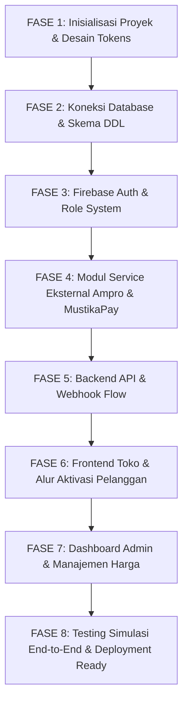

# Master Architecture & Execution Blueprint (Anti-Amnesia)
**Proyek:** Website Jualan Alight Motion Premium (AM Pro)  
**Dokumen Ini Adalah:** Sumber kebenaran tunggal (*Single Source of Truth*) agar AI & Developer selalu konsisten dari awal hingga akhir pengerjaan.

---

## 1. Ringkasan Arsitektur & Spesifikasi Kunci

| Komponen | Spesifikasi / Pilihan | Keterangan |
| :--- | :--- | :--- |
| **Framework Utama** | **Next.js (App Router) + TypeScript** | Fullstack (Frontend UI + Backend API Routes dalam 1 repositori). |
| **Styling & Desain** | **Tailwind CSS + Lucide Icons** | Tema: *Dark Mode OLED (`#090A0F`) + Neon Emerald (`#10B981`)*. |
| **Database** | **PostgreSQL (Supabase / Neon / VPS)** | Relasi data sesuai dokumen [ERD.md](file:///d:/COBA%20SAJA/ERD.md). |
| **Autentikasi & Role** | **Firebase Auth + Firebase Admin SDK** | Login Google & Email. Role: `customer`, `reseller`, `admin`. |
| **Payment Gateway** | **Mustika Payment (MustikaPay)** | Pembayaran QRIS otomatis via SNAP API (Perlu IP Statis di Production). |
| **API Activator** | **Ampro Activator (`ampro.enchant.id/api`)** | Endpoint 2 tahap: `POST /send-link` dan `POST /verify-link`. |

---

## 2. Struktur Folder & Tanggung Jawab Tiap File

Struktur direktori dirancang modular dan rapi:

```text
d:/COBA SAJA/
├── ERD.md                          # Referensi skema database & relasi tabel
├── PLANNING.md                     # File blueprint roadmap ini
├── .env.example                    # Template variabel lingkungan
├── package.json
├── tailwind.config.ts              # Konfigurasi token warna (Neon Emerald, OLED Dark)
├── src/
│   ├── app/                        # Next.js App Router
│   │   ├── layout.tsx              # Root layout (Font, Theme Provider, Toast)
│   │   ├── page.tsx                # Landing page utama (Katalog, Hero, Live Server Status)
│   │   ├── (auth)/
│   │   │   ├── login/page.tsx      # Halaman Login Firebase (Google / Email)
│   │   ├── (shop)/
│   │   │   ├── checkout/page.tsx   # Form input email target Alight Motion & nickname
│   │   │   ├── order/[invoice]/    # Halaman detail pesanan, tampilan QRIS & stepper aktivasi
│   │   │   │   └── page.tsx
│   │   ├── (member)/
│   │   │   ├── dashboard/page.tsx  # Dashboard pelanggan (Riwayat pesanan & lisensi saya)
│   │   │   ├── reseller/page.tsx   # Dashboard reseller (Katalog harga diskon & deposit)
│   │   ├── admin/                  # Dashboard Admin (Role Restricted)
│   │   │   ├── layout.tsx          # Admin sidebar & proteksi role
│   │   │   ├── page.tsx            # Statistik omzet, total aktivasi, chart
│   │   │   ├── products/page.tsx   # Atur harga reguler & harga reseller
│   │   │   ├── orders/page.tsx     # Tabel monitor semua order & tombol force activate
│   │   │   ├── settings/page.tsx   # Atur API key MustikaPay & toggle maintenance
│   │   └── api/                    # Backend API Routes
│   │       ├── auth/
│   │       │   └── sync-user/route.ts       # Sinkronisasi user Firebase ke database PostgreSQL
│   │       ├── ampro/
│   │       │   ├── status/route.ts          # Proxy cek healthcheck server Ampro
│   │       │   └── send-link/route.ts       # Pemicu pengiriman magic link ke email customer
│   │       ├── orders/
│   │       │   ├── create/route.ts          # Buat order & panggil MustikaPay untuk buat QRIS
│   │       │   ├── [invoice]/route.ts       # Polling status order & pembayaran
│   │       │   └── activate/route.ts        # Endpoint verifikasi magic link ke Ampro
│   │       ├── webhooks/
│   │       │   └── mustikapay/route.ts      # Webhook callback penerima status lunas dari gateway
│   │       └── admin/
│   │           ├── settings/route.ts        # CRUD konfigurasi sistem
│   │           └── users/route.ts           # Manajemen role dan saldo pengguna
│   ├── components/                 # Reusable UI Components
│   │   ├── ui/                     # Tombol, input, badge, modal dialog
│   │   ├── layout/
│   │   │   ├── Navbar.tsx          # Navigasi, info saldo/role, tombol login/profil
│   │   │   └── Footer.tsx
│   │   ├── shop/
│   │   │   ├── ServerStatusBadge.tsx # Indikator pulsing green dot server online
│   │   │   ├── ProductCard.tsx       # Kartu paket aktivasi
│   │   │   ├── QrisDisplay.tsx       # Render QR code pembayaran + countdown timer
│   │   │   └── ActivationStepper.tsx # 3-Langkah aktivasi (Bayar -> Buka Email -> Tempel Link)
│   │   └── admin/
│   │       ├── AdminSidebar.tsx
│   │       └── OrderActionModal.tsx
│   ├── lib/                        # Utilitas & Koneksi External Service
│   │   ├── db.ts                   # Koneksi Prisma / PostgreSQL / Supabase
│   │   ├── firebase-client.ts      # Inisialisasi Firebase SDK (Frontend login)
│   │   ├── firebase-admin.ts       # Inisialisasi Firebase Admin SDK (Verifikasi token & claim role)
│   │   ├── ampro.ts                # Helper Axios pemanggil API Ampro (/status, /send-link, /verify-link)
│   │   ├── mustikapay.ts           # Helper integrasi SNAP / Create QRIS Mustika Payment
│   │   └── utils.ts                # Format mata uang (Rupiah), format tanggal, cipher token
│   └── types/                      # TypeScript Definitions
│       ├── order.ts
│       ├── user.ts
│       └── ampro.ts
```

---

## 3. Urutan Eksekusi Wajib (Top-to-Bottom Execution Order)

> **PENTING UNTUK AI:** Kerjakan langkah-langkah ini secara berurutan dari **FASE 1 sampai FASE 8**. Jangan melompati fase agar kode tidak ada yang *broken* atau referensinya hilang.



---

### [ ] FASE 1: Inisialisasi Proyek & Desain Tokens
1. Inisialisasi aplikasi Next.js (TypeScript, Tailwind CSS, ESLint, App Router).
2. Install dependensi wajib:
   - `firebase` (Client SDK)
   - `firebase-admin` (Backend SDK)
   - `axios` (HTTP client untuk Ampro & MustikaPay)
   - `lucide-react` (Ikon UI)
   - `qrcode.react` (Render QRIS instan di frontend)
   - `pg` / `@prisma/client` / `@supabase/supabase-js` (Koneksi database)
3. Konfigurasi `tailwind.config.ts` dan `src/app/globals.css` dengan token palet:
   - Background: `#090A0F`
   - Surface/Card: `#12141C`
   - Input: `#181B26`
   - Border: `#242838`
   - Neon Emerald Accent: `#10B981` (dengan box-shadow glow)

---

### [ ] FASE 2: Koneksi Database & Skema DDL
1. Buat file `.env.example` dengan semua variabel yang didefinisikan.
2. Buat koneksi database di [src/lib/db.ts](file:///d:/COBA%20SAJA/src/lib/db.ts).
3. Buat migration / eksekusi DDL script dari [ERD.md](file:///d:/COBA%20SAJA/ERD.md) untuk tabel:
   - `users`
   - `packages`
   - `orders`
   - `payments`
   - `activations`
   - `webhook_logs`
   - `system_settings`
4. Buat file TypeScript definition di `src/types/` untuk tiap model tabel.

---

### [ ] FASE 3: Firebase Auth & Role-Based Access Control (RBAC)
1. Setup [src/lib/firebase-client.ts](file:///d:/COBA%20SAJA/src/lib/firebase-client.ts) (Inisialisasi aplikasi client untuk Google Pop-up Login).
2. Setup [src/lib/firebase-admin.ts](file:///d:/COBA%20SAJA/src/lib/firebase-admin.ts) (Inisialisasi service account untuk verifikasi session token & claim role).
3. Buat API Route `src/app/api/auth/sync-user/route.ts`:
   - Menerima ID Token dari frontend saat user berhasil login.
   - Menyimpan atau memperbarui data user di tabel `users`.
   - Mengembalikan data profil & `role` (`customer`, `reseller`, `admin`).
4. Buat middleware proteksi rute:
   - Rute `/admin/*` hanya boleh dibuka jika token memiliki role `admin`.
   - Rute `/reseller/*` hanya boleh dibuka jika role `reseller` atau `admin`.

---

### [ ] FASE 4: Service Integrasi Eksternal (Ampro & MustikaPay)
1. Buat client pembungkus API Ampro di [src/lib/ampro.ts](file:///d:/COBA%20SAJA/src/lib/ampro.ts):
   - `checkServerStatus()` -> `GET https://ampro.enchant.id/api/status`
   - `requestMagicLink(email)` -> `POST https://ampro.enchant.id/api/send-link`
   - `verifyAndActivate(email, magicLink, nickname)` -> `POST https://ampro.enchant.id/api/verify-link`
   - `getActivatorStats()` -> `GET https://ampro.enchant.id/api/stats`
2. Buat client pembungkus Mustika Payment di [src/lib/mustikapay.ts](file:///d:/COBA%20SAJA/src/lib/mustikapay.ts):
   - Fungsi `createQrisTransaction({ invoice, amount, customerName })`
   - Fungsi `verifyWebhookSignature(headers, body)`

---

### [ ] FASE 5: Backend API Routes & Alur Transaksi
1. **API Buat Pesanan (`src/app/api/orders/create/route.ts`)**:
   - Validasi email target Alight Motion & paket yang dipilih.
   - Generate nomor faktur: `INV-YYYYMMDD-XXXX`.
   - Simpan order dengan status `PENDING`.
   - Panggil Mustika Payment untuk mendapatkan string QRIS.
   - Simpan detail di tabel `payments`.
   - Kembalikan nomor invoice dan data QRIS ke frontend.
2. **Webhook Callback (`src/app/api/webhooks/mustikapay/route.ts`)**:
   - Catat log request di tabel `webhook_logs`.
   - Verifikasi status pembayaran dari MustikaPay.
   - Jika status = LUNAS / SETTLEMENT:
     - Update status order menjadi `PAID`.
     - **Otomatis panggil Ampro `requestMagicLink(target_email)`**.
     - Update status order menjadi `WAITING_LINK`.
3. **API Aktivasi Lisensi (`src/app/api/orders/activate/route.ts`)**:
   - Menerima `invoice` dan `magicLink` yang dimasukkan pelanggan.
   - Panggil Ampro `verifyAndActivate(target_email, magicLink, target_nickname)`.
   - Jika sukses:
     - Simpan data aktivasi (`am_uid`, `orderId`, `validUntil`, token) ke tabel `activations`.
     - Update status order menjadi `COMPLETED`.
   - Jika gagal:
     - Kembalikan pesan error ke user (misal: "Link sudah kedaluwarsa, silakan klik kirim ulang link").
4. **API Kirim Ulang Link (`src/app/api/orders/resend-link/route.ts`)**:
   - Memungkinkan user mengirim ulang magic link jika link sebelumnya kedaluwarsa (maksimal 3x).

---

### [ ] FASE 6: Frontend Pelanggan & Alur Interaktif
1. **Navbar & Header**:
   - Status indikator server Ampro realtime (Online/Offline).
   - Tombol Login / Info Akun & Role.
2. **Landing Page (`src/app/page.tsx`)**:
   - Hero banner bergaya neon tech.
   - Katalog paket lisensi (menampilkan harga reguler untuk user umum, atau harga diskon jika login sebagai reseller).
3. **Halaman Transaksi & Aktivasi (`src/app/(shop)/order/[invoice]/page.tsx`)**:
   - **Kondisi 1 (Status: PENDING)**: Tampilkan nominal, timer countdown, dan QR Code QRIS untuk di-scan.
   - **Kondisi 2 (Status: WAITING_LINK)**: Tampilkan instruksi panduan:
     *"Buka email kamu (inbox/spam) dari Alight Motion, salin link login yang masuk, lalu tempelkan di kotak bawah ini."*
   - Input box untuk menempelkan `magicLink` + tombol **"Aktifkan Premium Sekarang"**.
   - Tombol darurat: *"Kirim Ulang Link ke Email"* (dengan cooldown 60 detik).
   - **Kondisi 3 (Status: COMPLETED)**: Kartu sukses warna hijau neon dengan rincian masa aktif lisensi (1 tahun) dan tombol *"Buka Alight Motion"*.

---

### [ ] FASE 7: Dashboard Admin & Kontrol Bisnis
1. **Halaman Atur Harga (`src/app/admin/products/page.tsx`)**:
   - Form ubah harga reguler & harga reseller secara instan di database tanpa ubah kode.
2. **Halaman Monitor Transaksi (`src/app/admin/orders/page.tsx`)**:
   - Tabel realtime seluruh pesanan pelanggan.
   - Filter berdasarkan status: `PENDING`, `WAITING_LINK`, `COMPLETED`.
   - Tombol aksi admin: *"Input Link Manual"* (membantu pelanggan yang kesulitan) atau *"Kirim Ulang Magic Link"*.
3. **Halaman Pengaturan API (`src/app/admin/settings/page.tsx`)**:
   - Konfigurasi Merchant ID & API Key Mustika Payment.
   - Toggle toko buka/tutup (*Maintenance mode*).

---

### [ ] FASE 8: Pengujian Akhir & Siap Rilis
1. Simulasi alur penuh (*End-to-End Test*):
   - User Checkout -> Bayar -> Webhook terpanggil -> Magic Link terkirim -> Paste Link -> Lisensi Sukses Aktif.
2. Penanganan kasus khusus (*Edge Cases*):
   - Mencegah double callback (Idempotency).
   - Penanganan jika server Ampro sedang offline (`/status` != online).
   - Batas maksimal retry link untuk mencegah spam email.
3. Siapkan dokumentasi deployment untuk VPS (mengamankan IP Statis untuk webhook Mustika Payment).

---

## 4. Cara Menjaga Agar AI Tidak Amnesia

Setiap kali memulai sesi baru atau melanjutkan pembuatan kode:
1. Periksa bagian **Urutan Eksekusi Wajib** di file ini.
2. Beritahukan AI: *"Lanjutkan pengerjaan ke FASE X sesuai file PLANNING.md"*.
3. Cek centang `[x]` pada fase yang sudah selesai dikerjakan.
